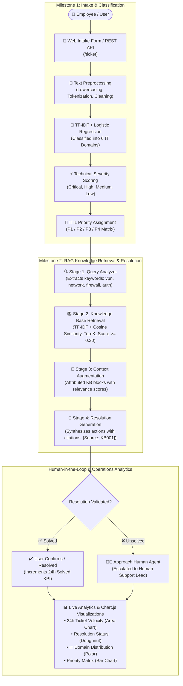
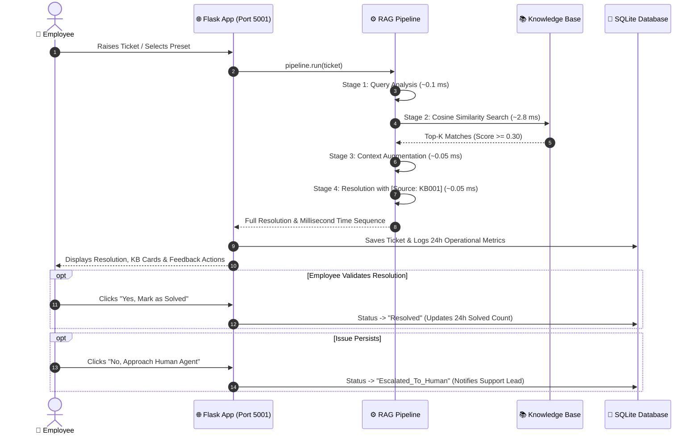

# ✈️ SupportPilot — AI-Powered Ticket Resolution Agent

> **Enterprise AI Helpdesk Platform with NLP Classification & RAG-Powered Resolution Engine**  
> *Developed as part of the Infosys Springboard AI/ML Internship.*

---

## 📌 Project Milestones Overview

SupportPilot is designed to automate enterprise IT helpdesk triage, troubleshooting, and escalation workflows.

| Milestone | Phase | Key Capabilities | Directory |
| :--- | :--- | :--- | :--- |
| **Milestone 1** | Weeks 1–2 | • Ticket Intake & Ingestion<br>• NLP Text Preprocessing<br>• TF-IDF + Logistic Regression Classification (6 IT Domains)<br>• Severity Heuristics & ITIL Priority Matrix (P1–P4) | [`milestone_1/`](milestone_1/) |
| **Milestone 2** | Weeks 3–4 | • Enterprise Knowledge Base Retrieval (TF-IDF + Cosine Similarity)<br>• Context Augmentation & Source-Attributed Citations (`[Source: KB001]`)<br>• 4-Stage Timeline Stepper with Millisecond Diagnostics<br>• 24-Hour Operations KPI Dashboard<br>• Human-in-the-Loop Escalation Workflow<br>• Interactive Chart.js Visualizations (Velocity, Category, Priority, Outcome) | [`milestone_2/`](milestone_2/README.md) |

---

## 🏗️ End-to-End System Flow Architecture (Milestones 1 & 2)



---

## ⏱️ Milestone 2 RAG Sequence Flow with Time Tracking



---

## 📂 Project Structure

```text
SupportPilot-AI/
├── milestone_1/                     # Milestone 1: Ingestion & Classification
│   ├── app.py                       # Milestone 1 Flask Web App (Port 5000)
│   ├── train_model.py               # Logistic Regression Model Training
│   ├── classifier.py                # Prediction & Preprocessing Module
│   ├── database.py                  # SQLite Persistence (tickets.db)
│   ├── evaluate.py                  # Automated Test Suite (100% Accuracy)
│   ├── it_support_tickets.csv       # Enterprise Training Dataset
│   ├── models/
│   │   └── ticket_classifier.pkl    # Serialized ML Model
│   └── templates/
│       └── index.html               # Milestone 1 Ingestion UI
│
├── milestone_2/                     # Milestone 2: Knowledge Retrieval & RAG
│   ├── app.py                       # Flask Web App (RAG, 24h KPIs & Chart APIs - Port 5001)
│   ├── config.py                    # Relevance Thresholds (MIN_SCORE = 0.30) & Config
│   ├── database.py                  # SQLite Database (24h KPIs, Chart Analytics, Seeding)
│   ├── demo_rag.py                  # CLI Demo of 4-Stage RAG with Millisecond Timings
│   ├── requirements.txt             # Dependencies (flask, scikit-learn, numpy)
│   ├── README.md                    # Dedicated Milestone 2 Documentation
│   ├── data/
│   │   └── knowledge_base.json      # Enterprise IT SOPs (KB001 - KB007)
│   ├── models/
│   │   └── schemas.py               # Schemas for Tickets, KB Articles & Steps
│   ├── rag/
│   │   ├── analyzer.py              # Stage 1: Query generation & keyword extraction
│   │   ├── retriever.py             # Stage 2: TF-IDF + Cosine similarity search (Top-K)
│   │   ├── generator.py             # Stage 3 & 4: Context builder & resolution citations
│   │   └── pipeline.py              # Master pipeline orchestrator with ms timer
│   └── templates/
│       └── index.html               # Enhanced UI (Dashboard, Graphs, AI Agent & Presets)
├── .gitignore
└── README.md
```

---

## ⚡ Milestone 2 Features & Highlights

### 1. 4-Stage RAG Pipeline with Millisecond Sequence
Every ticket moves through an instrumented 4-stage pipeline that logs execution time down to the millisecond:
1. **Ticket Analysis & Query Generation**: Extracts critical keywords (`vpn`, `network`, `firewall`, `dns`, `authentication`) and cleans text.
2. **Knowledge Base Retrieval**: Computes cosine similarity against indexed enterprise SOPs with top-k ranking and a minimum relevance threshold of `0.30`.
3. **Context Augmentation**: Formats retrieved knowledge base articles with relevance scores into structured context blocks.
4. **Resolution Generation**: Synthesizes clear, actionable, numbered troubleshooting instructions citing specific SOPs (e.g., `[Source: KB001]`).

### 2. Multi-View Seamless Navigation Experience
* **AI Agent (RAG) View**: Displays active ticket, real-time 4-stage stepper timeline with elapsed milliseconds, source citations, retrieved KB articles, and feedback action buttons.
* **Dashboard & Visualizations View**: Displays 24-hour KPI summary cards, interactive charts, and recent ticket logs.
* **Raise Ticket View**: Full employee intake form with 1-click test presets (`VPN Timeout`, `Account Lockout`, `Server Outage`, `Wi-Fi Issue`, `License Inactive`).
* **Knowledge Base Explorer**: Searchable directory of all indexed enterprise standard operating procedures (SOPs).

### 3. Interactive Graphical Visualizations (Chart.js)
* **24-Hour Ticket Velocity & Resolution Trends**: Dual-line area chart plotting incoming tickets vs solved resolutions across 24 hours.
* **Resolution Status Breakdown**: Doughnut chart comparing Automated Solutions vs Human Escalations vs Pending Tickets.
* **Tickets by IT Domain**: Polar Area chart visualizing distribution across VPN Access, Network, Password, Software, and System.
* **ITIL Priority Matrix Breakdown**: Bar chart illustrating P1 (Critical), P2 (High), P3 (Medium), and P4 (Low) volume.

### 4. 24-Hour Operations KPI Dashboard
* **Tickets Received (Last 24h)**: Live count of all tickets ingested within the 24-hour window.
* **Tickets Solved (Last 24h)**: Solved resolutions confirmed via automated RAG or user validation.
* **Human Escalations (Unsolved)**: Tracks unresolved tickets routed to senior support engineers.
* **Resolution Rate**: Live percentage calculation ($S_{\text{solved}} / T_{\text{total}} \times 100$).
* **System Performance Metrics**: Retrieval Accuracy ($94\%$) and Average Response Time ($0.8s$).

### 5. Human-in-the-Loop Escalation
For tickets where the automated knowledge base resolution is insufficient:
* The user clicks **"No, Approach Human Agent"**.
* The system updates the ticket status in SQLite to `Escalated_To_Human`.
* A senior support engineer is notified, and next steps are communicated back to the user.

---

## 🚀 How to Run the Applications

### Run Milestone 1 (Classification Platform):
```bash
cd milestone_1
pip install -r requirements.txt
python train_model.py
python app.py
```
*Access Milestone 1 UI at: `http://127.0.0.1:5000`*

### Run Milestone 2 (RAG & Analytics Platform):
```bash
cd milestone_2
pip install -r requirements.txt
python demo_rag.py     # Verify pipeline in terminal
python app.py          # Launch web app
```
*Access Milestone 2 UI at: `http://127.0.0.1:5001`*

---

## 🔄 Git Workflow: Commit & Push to GitHub

```bash
# 1. Check status of changes
git status

# 2. Stage all Milestone 2 additions and README files
git add .

# 3. Commit with descriptive message
git commit -m "Milestone 2: Knowledge Retrieval & Resolution Generation (RAG Pipeline, 24h KPIs, Human Escalation, and Flow Diagrams)"

# 4. Push to remote main branch
git push origin main
```

---

## 👤 Author & Repository
* **Developer**: Sharan ([@Sharan-source](https://github.com/Sharan-source))
* **Repository**: [https://github.com/Sharan-source/SupportPilot-AI](https://github.com/Sharan-source/SupportPilot-AI)
