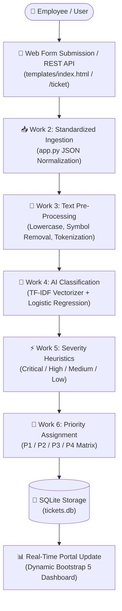

# ✈️ SupportPilot — AI-Powered Ticket Resolution Agent

> **Milestone 1: Automated Ticket Intake, Text Pre-processing, Classification & Severity Scoring**  
> *Developed as part of the Infosys Springboard AI/ML Internship.*

---

## 📌 Project Overview

**SupportPilot** is an intelligent, multi-module enterprise IT support automation system designed to streamline helpdesk operations. Modern enterprises face high volumes of repetitive IT support requests that strain support staff and cause resolution delays.

**Milestone 1** focuses on **Module 1 (Ticket Intake & Classification)**: receiving raw user tickets through a web interface or REST API, cleaning and vectorizing the text, classifying the issue into one of six IT domains, predicting technical severity, assigning ITIL operational priorities (P1–P4), and persisting records into an SQLite database.

---

## 🏗️ System Architecture (Milestone 1)



---

## 🏷️ Category Taxonomy & Priority Matrix

### 1. Six Target Enterprise Categories
| Category | Scope & Example Issues |
| :--- | :--- |
| **`Network`** | Wi-Fi connectivity failures, DNS resolution errors, slow internet, LAN cable issues. |
| **`VPN`** | Cisco AnyConnect authentication errors, connection drops, gateway timeouts. |
| **`Password`** | Active Directory lockouts, domain password resets, 2FA token expiration, SSO issues. |
| **`Software`** | MS Office 365 provisioning, Zoom app crashes, Docker Desktop installation, VS Code errors. |
| **`Hardware`** | Unresponsive laptop keyboard, monitor display black screen, printer paper jam, battery degradation. |
| **`System`** | Production server outages, database cluster errors, BSOD crashes, security breaches. |

### 2. ITIL Priority Decision Matrix
Priority determines resolution urgency based on technical **Severity** and **Business Impact**:

| Technical Severity | Business Impact | Assigned Priority | Operational SLA Target |
| :---: | :---: | :---: | :--- |
| **Critical** | Any / High | **P1 (Critical)** | Immediate escalation (< 1 Hour) |
| **High** | High (Client meeting / Urgency) | **P1 (Critical)** | Priority resolution (< 2 Hours) |
| **High** | Normal | **P2 (High)** | Standard high priority (< 4 Hours) |
| **Medium** | Normal | **P3 (Medium)** | Standard queue (< 24 Hours) |
| **Low** | Normal | **P4 (Low)** | Routine service request (< 3 Days) |

---

## 🛠️ Technology Stack

* **Programming Language**: Python 3.10+
* **Backend Framework**: Flask (RESTful Endpoints)
* **Text Processing**: Scikit-learn `TfidfVectorizer` (Unigram + Bigram feature extraction)
* **Machine Learning Algorithm**: Scikit-learn `LogisticRegression`
* **Model Serialization**: `joblib`
* **Database**: SQLite3 (ACID-compliant relational persistence)
* **Frontend UI**: HTML5, Bootstrap 5, Bootstrap Icons, Asynchronous Fetch API

---

## 📂 Project Directory Structure

```text
SupportPilot-AI/
└── milestone_1/
    ├── app.py                  # Flask web controller & REST API routing
    ├── train_model.py          # Machine learning training & serialization pipeline
    ├── classifier.py           # NLP inference, severity scoring, and priority logic
    ├── database.py             # SQLite database initialization & CRUD queries
    ├── evaluate.py             # Automated test suite measuring milestone targets
    ├── it_support_tickets.csv  # 600-sample balanced enterprise IT training dataset
    ├── requirements.txt        # Python dependency manifest
    │
    ├── models/
    │   └── ticket_classifier.pkl  # Trained model artifact
    │
    ├── templates/
    │   └── index.html          # Responsive SupportPilot helpdesk dashboard
    │
    └── tickets.db              # Local SQLite database (auto-generated)
```

---

## 🚀 Getting Started & Execution

### 1. Prerequisites
Ensure Python 3.10+ is installed on your computer:
```bash
python --version
```

### 2. Clone the Repository
```bash
git clone https://github.com/Sharan-source/SupportPilot-AI.git
cd SupportPilot-AI/milestone_1
```

### 3. Install Dependencies
```bash
pip install -r requirements.txt
```

### 4. Train the Model
Train the TF-IDF and Logistic Regression pipeline on the dataset:
```bash
python train_model.py
```
*Output will confirm model evaluation and save `models/ticket_classifier.pkl`.*

### 5. Run the Automated Evaluation Test Suite
Validate project compliance against Milestone 1 targets:
```bash
python evaluate.py
```

### 6. Launch the Web Platform
Start the Flask server:
```bash
python app.py
```
Open your browser and navigate to:
```text
http://127.0.0.1:5000
```

---

## 📊 Milestone 1 Evaluation Targets & Verification

The project specification mandates the following evaluation criteria:
* **Ticket Classification Accuracy Target**: $\ge 90\%$
* **Severity Prediction Accuracy Target**: $\ge 85\%$

### Automated Evaluation Results (`evaluate.py`)
```text
Running Milestone 1 Evaluation Test Suite...
=======================================================
Classification Accuracy : 20/20 = 100.0%  (Target: ≥ 90% | PASS)
Severity Accuracy       : 20/20 = 100.0%  (Target: ≥ 85% | PASS)
=======================================================
Status: PASS (All Milestone 1 Criteria Satisfied)
```

---

## 🔌 REST API Documentation

### Ingest and Classify Ticket
* **Endpoint**: `POST /ticket` (also available via `/api/tickets`)
* **Content-Type**: `application/json`

#### Request Payload:
```json
{
  "title": "VPN is not connecting",
  "description": "Unable to connect to company VPN from home. I have an important client meeting in 30 minutes.",
  "email": "arun@company.com",
  "employee_name": "Arun"
}
```

#### Response Payload (`201 Created`):
```json
{
  "ticket_id": 1001,
  "ticket": "Unable to connect to company VPN from home. I have an important client meeting in 30 minutes.",
  "category": "VPN",
  "severity": "High",
  "priority": "P1",
  "confidence": "94.2%",
  "status": "Open"
}
```

---

## 🗺️ Roadmap: Upcoming Milestones

* [x] **Milestone 1**: Ticket Processing, Classification, and Severity/Priority Engine.
* [ ] **Milestone 2**: Knowledge Retrieval Engine (Vector Search & IT SOP FAQ matching).
* [ ] **Milestone 3**: AI Resolution Generator (Automated step-by-step troubleshooting).
* [ ] **Milestone 4**: Multi-Agent Resolution Framework (Intake, Specialist, and Validation Agents).
* [ ] **Milestone 5**: Escalation & Human-in-the-Loop Workflow Management.
* [ ] **Milestone 6**: Analytics Dashboard & KPI Reporting.

---

## 👤 Author
* **Developer**: Sharan ([@Sharan-source](https://github.com/Sharan-source))
* **Organization**: Infosys Springboard Internship