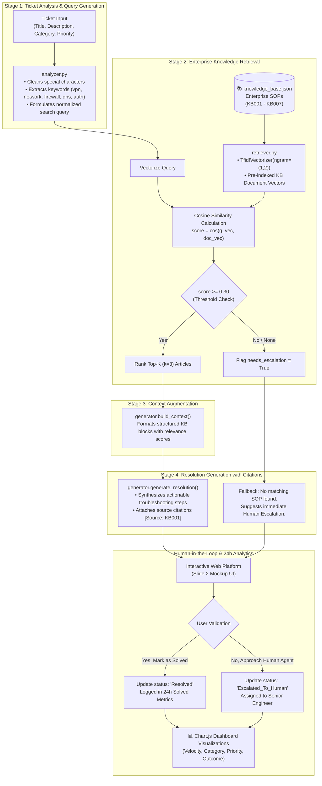
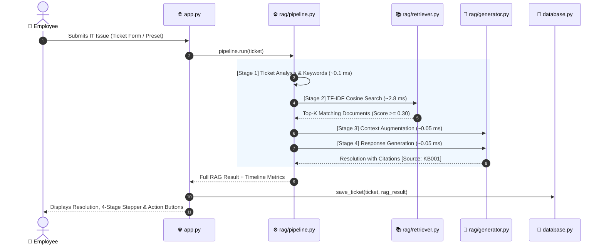
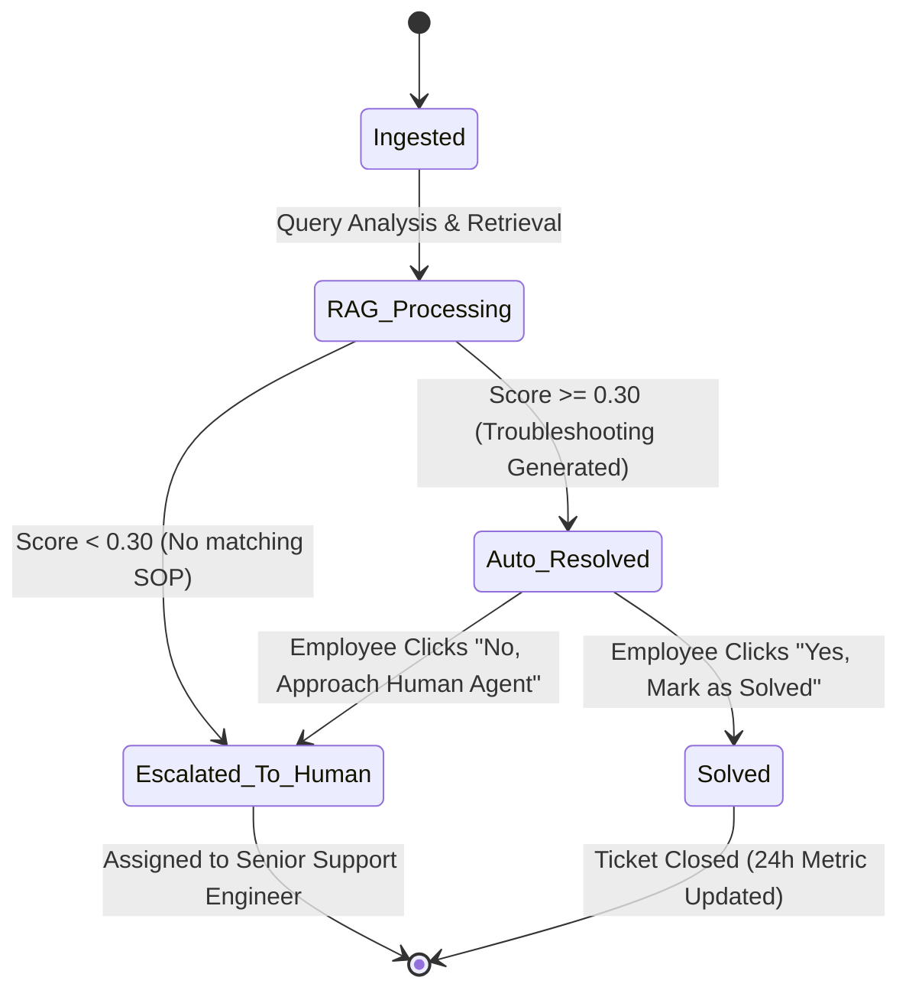

# 🧠 SupportPilot — Milestone 2: Knowledge Retrieval & Resolution Generation (RAG)

> **Enterprise AI Helpdesk Platform — Module 2: RAG-Powered Resolution Engine & Live Analytics**  
> *Developed as part of the Infosys Springboard AI/ML Internship.*

---

## 📌 Milestone 2 Overview

Milestone 2 advances the **SupportPilot** platform from classification to automated intelligent troubleshooting. It implements an enterprise **Retrieval-Augmented Generation (RAG)** pipeline that:
1. Takes classified IT tickets from Milestone 1.
2. Extracts key technical query terms.
3. Retrieves relevant Standard Operating Procedures (SOPs) from an enterprise Knowledge Base using **TF-IDF Vectorization** and **Cosine Similarity Ranking**.
4. Augments context with threshold validation ($\ge 0.30$ relevance).
5. Generates step-by-step troubleshooting actions explicitly cited to internal knowledge articles (e.g., `[Source: KB001]`).
6. Tracks elapsed execution time across 4 stages in milliseconds.
7. Logs 24-hour operational KPIs (Received, Solved, Escalated, Resolution Rate).
8. Supports **Human-in-the-Loop escalation** for unresolved tickets.
9. Displays interactive analytics graphs using **Chart.js**.

---

## 🏗️ Detailed RAG Workflow & Architecture



---

## ⏱️ Real-Time 4-Stage Timeline Sequence

Every ticket processed by the RAG engine logs each stage with millisecond precision:



---

## 📂 Milestone 2 File Directory

| File / Folder | Role & Implementation Details |
| :--- | :--- |
| **`app.py`** | Flask application hosting RAG endpoints, 24-hour KPI calculations, Chart.js analytics API, and HTML rendering on port `5001`. |
| **`config.py`** | Defines `MIN_RELEVANCE_THRESHOLD = 0.30`, `TOP_K_DOCUMENTS = 3`, and database/KB file paths. |
| **`database.py`** | SQLite persistence (`supportpilot_m2.db`), calculates 24-hour KPIs, provides structured chart analytics, and seeds initial data. |
| **`demo_rag.py`** | Terminal CLI test demonstrating the entire 4-stage RAG pipeline with millisecond timing diagnostics. |
| **`data/knowledge_base.json`** | Enterprise knowledge base containing SOPs for VPN, Network Firewall, Authentication/MFA, Wi-Fi/DNS, Password Unlock, Software Provisioning, and Server Downtime. |
| **`models/schemas.py`** | Dataclasses for `TicketInput`, `KBArticle`, and `WorkflowStep`. |
| **`rag/analyzer.py`** | Extracts domain keywords (`vpn`, `network`, `firewall`, `dns`, `authentication`) and builds normalized query. |
| **`rag/retriever.py`** | Uses `TfidfVectorizer(ngram_range=(1,2))` and `cosine_similarity` to retrieve and rank KB articles matching criteria. |
| **`rag/generator.py`** | Builds augmented context blocks and generates step-by-step troubleshooting actions with `[Source: KB001]` citations. |
| **`rag/pipeline.py`** | Orchestrates the 4 stages, measuring elapsed time in milliseconds for each phase. |
| **`templates/index.html`** | UI featuring Milestone banner, 24h KPI cards, RAG stepper, human escalation actions, and 4 Chart.js graphs. |

---

## 📊 Dashboard Visualizations & Graphs (Chart.js)

The Milestone 2 platform provides 4 real-time interactive charts:

1. **24-Hour Ticket Velocity & Resolution Trends (Line/Area Chart)**:
   - Compares hourly ticket ingestion rates against completed resolutions over the last 24 hours.
2. **Resolution Status Breakdown (Doughnut Chart)**:
   - Visualizes the proportion of **Automated Solved** tickets vs. **Escalated to Human Agent** vs. **Open**.
3. **Tickets by IT Category (Polar Area Chart)**:
   - Displays distribution across enterprise categories: *VPN Access*, *Network Connectivity*, *Password Reset*, *Software Provisioning*, and *System Outage*.
4. **ITIL Priority Matrix Breakdown (Bar Chart)**:
   - Highlights ticket volume across *P1 - Critical*, *P2 - High*, *P3 - Medium*, and *P4 - Low*.

---

## 🚨 Human-in-the-Loop Escalation Protocol



* **"Yes, Mark as Solved"**: Validates the resolution, closes the ticket, and increments the 24-hour solved count.
* **"No, Approach Human Agent"**: Updates status to `Escalated_To_Human`, records the escalation in the 24-hour dashboard, and displays immediate guidance on support team assignment.

---

## 🔌 API Endpoints

### 1. Ingest Ticket & Run RAG Pipeline
* **Endpoint**: `POST /api/tickets/rag`
* **Payload**:
```json
{
  "title": "VPN connection failing on corporate network",
  "description": "Connection timed out on IPsec gateway port 500.",
  "category": "VPN Access",
  "priority": "High",
  "employee_name": "Arun Kumar",
  "email": "arun.k@company.com",
  "department": "Engineering"
}
```
* **Response**: Returns ticket ID, RAG resolution with citations, retrieved KB documents with scores, 4-stage timeline metrics, and updated 24h statistics.

### 2. Mark Ticket as Solved
* **Endpoint**: `POST /api/tickets/<ticket_id>/resolve`
* **Response**: Sets status to `Resolved` and returns updated 24h KPIs.

### 3. Escalate Ticket to Human Agent
* **Endpoint**: `POST /api/tickets/<ticket_id>/escalate`
* **Response**: Sets status to `Escalated_To_Human` and returns escalation confirmation.

### 4. Fetch Chart Analytics Data
* **Endpoint**: `GET /api/dashboard/charts`
* **Response**: JSON dataset for hourly trends, category breakdown, priority distribution, and resolution outcomes.

### 5. Knowledge Base Catalog
* **Endpoint**: `GET /api/knowledge-base`
* **Response**: Complete collection of indexed enterprise SOPs.

---

## 🚀 Execution & Testing Guide

### Step 1: Install Requirements
```bash
pip install -r requirements.txt
```

### Step 2: Run Terminal Pipeline Verification
```bash
python demo_rag.py
```

### Step 3: Launch Web Application
```bash
python app.py
```
Open your browser at:
👉 **`http://127.0.0.1:5001`**
